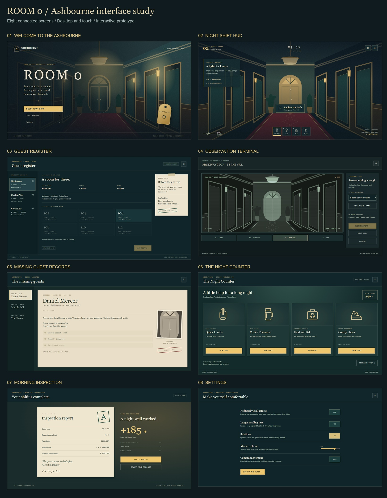

# Ashbourne interface — first design suite

Eight connected screen designs for **ROOM 0**, with desktop and touch layouts. Open [the interactive prototype](ashbourne-interface.html) in a browser. It is self-contained and works offline; refresh the page to reset its sample state. In Obsidian, reveal the HTML in Explorer and open it in your browser if it does not open directly.

## Direction

The interface belongs to the Ashbourne: engraved brass, deep teal equipment, cream hotel stationery, burgundy details and a restrained green security monitor. Headings recall hotel signage; monospaced metadata recalls registers, receipts and surveillance equipment. Ordinary guest requests sit alongside the missing-person investigation without presenting every guest as a threat.

The corridor is an original SVG concept illustration made for these mockups, not a screenshot of a finished Roblox environment. Its purpose is to test the hierarchy and contrast of the UI against a hotel scene. Production should replace it with the actual environment or an approved title backdrop.

Related standards and sources: [[Art Bible]], [[Ordinary Guests - Index]], [[Ordinary Guests - Design Bible]], [[Health]], [[CCTV System]], [[Hotel Shop]], [[End of Shift Inspection]]. Refer to the actual gameplay notes for final rules; the prototype demonstrates an interface, not a new source of gameplay canon.

## Screens and interaction states

| Screen | Design and working preview behaviour |
|---|---|
| Welcome | Ashbourne arch monogram, ROOM 0 title, brass key tag, shift entrance, guest archives and settings. A calm, unsettling hotel identity rather than an overt horror warning. |
| Shift HUD | Shift number, role, clock, one active guest request, small heartbeat/health indicator and four inventory slots. Leena Shah requests a replacement reading-lamp bulb. Select the bulb, then interact to complete the request. Selecting the wrong item gives a useful instruction. |
| Guest register | Arrival queue, named occupants, party size, stay length, capacity-aware room selection, guest's request on a paper slip and issue-keys action. Wedding trio Nia/Beth/Callum, Martin Pike and Gwen/Arthur Ellis are the example bookings. Insufficient capacity, occupied and unready rooms are disabled. A completed booking occupies its room. |
| CCTV | Four example camera channels, capture-frame action, report category, submit action, night vision and zoom. Reporting requires a captured frame and category. Switching cameras clears the previous capture. Submitted reports await verification rather than instantly awarding a correct answer. |
| Case records | Paper case folder for Daniel Mercer, recovered-evidence list and unresolved stamp. Marnie Bell and the Shaws have locked-case states. The view avoids exposing the author-facing explanations of Case 3's “again” and “this time.” |
| Night Counter | Four staff supplies, readable effect and duration, coin balance, confirmation/cancel, owned and insufficient-coins states. Quick Hands, Coffee Thermos, First Aid Kit and Comfy Shoes use original line icons. The stock-refresh entry explains that price and odds are undecided and charges nothing. |
| Inspection | Cream inspection sheet, grade stamp, task/care/maintenance figures, Inspector's message and separate personal/team coin contributions. Collecting pay updates the same preview wallet once. |
| Settings | Reduced effects removes grain/scanlines; larger text increases body/label sizes. Subtitle, camera-motion and volume controls demonstrate preference states; this silent prototype has no audio or engine camera to alter. |

## Visual specification

- **Identity colours:** brass `#F2C14E`, deep teal `#1F5C63`, burgundy `#8C1C2B`, consistent with the Art Bible.
- **Surface colours:** terminal base `#102529`, panel `#173438`, cream paper `#EDE4CF`, warm action fill `#EDC66E`. Use burgundy for exceptional/stamped states rather than making every action red.
- **Typography in this portable preview:** Georgia for display and stationery headings, Arial for instructions, Courier New for timestamps, room numbers and terminal metadata. Roblox font equivalents need a visual match check during implementation.
- **Hierarchy:** a single prominent brass primary action per task area, quiet outlined secondary actions, explicit status wording as well as colour. Most headings are 23–38 px; display title 102 px desktop/65 px touch. Supporting metadata is deliberately compact; the larger-text setting is an initial option, not a complete accessibility audit.
- **Shape language:** predominantly square forms, thin brass/cream rules, occasional arches and physical paper shadows. Rounded shapes belong to the monogram, key and touch controls rather than every panel.
- **Effects:** low-opacity grain and CRT scanlines, removed by reduced-effects preference. No flashing or flicker.
- **Assets:** corridor drawing and line icons are editable SVG embedded in the HTML. No external fonts, image downloads or runtime dependencies are required.

## Layout and input

The preview toolbar belongs to the review tool, not to the game. Use its eight tabs to inspect screens, and Desktop/Touch to change the stage width. The touch stage is 390 px wide; the layout changes below 700 px. Panels may scroll vertically. The arrival queue scrolls horizontally on narrow screens.

Desktop places the room queue, selection and guest note in three columns. Touch stacks selection and note beneath the scrollable queue. HUD touch actions remove the keyboard hint and expose Files/Menu controls. Shop cards become a two-column grid; inspection and CCTV panels stack. These are responsive browser layouts, not final Roblox safe-area calculations.

Buttons have visible keyboard focus. Modal actions trap Tab focus, Escape closes the modal and focus returns to its trigger. On the HUD, E interacts and 1–3 select the first three items. Browser clicks/taps work throughout. Gamepad navigation, Roblox CoreGui insets, notch safe areas, controller glyphs and device-specific minimum text sizes remain implementation work.

## Sample content and limits

- Room allocations, capacities, exact booking durations, request wording, opening time, shift clock, prices, balances, evidence counts, inspection scores and payout values are **illustrative design data**, not approved balancing or a fixed floor plan. Room 113 is omitted.
- The preview uses the existing ordinary-guest names and established missing-case identities. Its visible case progression is a sample; final disclosure timing must follow the narrative implementation.
- The four surveillance choices reuse/crop the concept illustration. They are not live cameras or accurate views of four built rooms. Capture/report stores demonstration state, not an image uploaded to a server.
- Item purchase and payout change an in-memory preview wallet only. Refresh resets everything. No Robux purchase, persistent save, multiplayer authority or backend connection is implemented.
- The HTML is a design reference. It is **not installed in Roblox Studio** and does not replace the game's Luau UI implementation.
- Figma created an empty file during this task, but its editing connection became unavailable. These designs are delivered in the local prototype and screenshots; **they have not been placed in Figma**.

## Review and handoff

This is a first design proposal for Rivin and Prescaled to review. Preserve the Art Bible's palette and the distinction between hotel stationery, front-desk equipment and security equipment when translating components into Roblox. Keep ordinary guest requests visible and personal; reserve case evidence for the archives.

Prioritise building the HUD and guest register first, followed by CCTV and inspection. Reuse buttons, type styles, headers, status labels, item slots, room tiles, paper panels, confirmations and notifications across screens. Gameplay services must validate room capacity/availability, inventory ownership, purchases, reports and rewards on the server. Never trust the prototype's client-only validation as a production implementation.

Review captures are in `previews/`. Automated browser checks verified the main interaction states and absence of horizontal screen overflow at desktop and touch widths. All eight desktop/touch screens were rendered; desktop core screens and the touch HUD/register were visually inspected.
